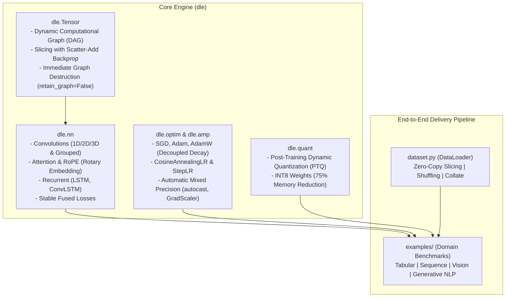

# DeepLearningEngine (`dle`)

A lightweight, zero-dependency, pure NumPy deep learning engine with dynamic autograd, PyTorch-compatible OOP APIs, modern Transformers, AMP, and INT8 quantization.

---

## Architecture Overview



---

## Quickstart: PyTorch Drop-in API

`dle` matches PyTorch's object-oriented mental model and execution syntax:

```python
import dle.nn as nn
from dle.optim import AdamW
from dataset import DataLoader, load_mnist

# 1. Define Model
class CNN(nn.Module):
    def __init__(self):
        super().__init__()
        self.conv = nn.Conv2d(1, 32, kernel_size=3, stride=2, padding=1)
        self.bn = nn.BatchNorm(32)
        self.fc = nn.Linear(32 * 14 * 14, 10)

    def forward(self, x):
        x = self.bn(self.conv(x)).relu()
        return self.fc(x.reshape(x.shape[0], -1))

# 2. Train Loop
(x_tr, y_tr), _ = load_mnist()
loader = DataLoader(x_tr, y_tr, batch_size=64)
model, opt, loss_fn = CNN(), AdamW(CNN().parameters(), lr=1e-3), nn.CrossEntropyLoss()

for x, y in loader:
    opt.zero_grad()
    loss = loss_fn(model(x), y)
    loss.backward()
    opt.step()
```

---

## Modular Examples & End-to-End Delivery

Each example in [`examples/`](examples/) implements the complete 5-stage lifecycle: **Data Loading $\to$ Model Summary $\to$ Training with LR Scheduling $\to$ Validation $\to$ Checkpoint & INT8 Quantization Delivery**.

| Task | Domain | Model Architecture | Dataset | Execution Script | Throughput & Accuracy |
| :--- | :--- | :--- | :--- | :--- | :--- |
| **Tabular** | Classification | MLP (2-layer, 64-hidden) | Wine Quality (6,497 samples) | `python examples/train_wine.py` | ~1,500 it/s (~50,000 samples/sec) |
| **Sequence** | Forecasting | Recurrent Memory (LSTM) | Sine Wave (5,000 steps) | `python examples/train_sine.py` | ~150 it/s ($R^2 \approx 1.000$, MAE < 0.003) |
| **Vision** | Classification | 2D CNN (Conv2d + BatchNorm) | MNIST (60,000 images) | `python examples/train_mnist.py` | ~73 it/s (89%+ accuracy in 1 epoch) |
| **NLP** | Generative LM | MiniGPT (Pre-LN + RoPE + Causal Attn) | Tiny Shakespeare (34k tokens) | `python examples/train_shakespeare.py` | ~4,100 tokens/sec (40%+ test accuracy) |

> Run all 4 benchmarks sequentially with unified verification:
> ```bash
> python training.py
> ```

---

## Core Feature Matrix

| Module | Key Components | Highlights |
| :--- | :--- | :--- |
| **`dle.tensor`** | `Tensor`, `cat`, `no_grad` | Reverse-mode DAG autograd; zero-copy slicing with `np.add.at` scatter-add; immediate graph destruction (`retain_graph=False`) for zero-leak flat RAM. |
| **`dle.nn`** | `Linear`, `Conv1d/2d/3d`, `ConvTranspose`, `LSTM`, `ConvLSTM`, `MultiHeadAttention`, `RotaryEmbedding` (RoPE), `BatchNorm`, `LayerNorm`, `Dropout` | Modular layers with automatic parameter discovery; analytical gradients; Grouped/Depthwise convolutions; Causal self-attention; Kaiming/Xavier initializers. |
| **`dle.optim`** | `SGD`, `Adam`, `AdamW`, `CosineAnnealingLR`, `StepLR` | Decoupled weight decay; first/second-moment debiasing; adaptive learning rate decay schedules. |
| **`dle.amp`** | `autocast`, `GradScaler` | Context-managed mixed precision GEMM; dynamic scale factor with automatic NaN/Inf overflow detection & backoff. |
| **`dle.quant`** | `QuantizedLinear`, `quantize_dynamic` | INT8 post-training dynamic quantization; 75% weight memory reduction; transparent hierarchical module converter. |
| **`dle.utils`** | `summary`, `save_model`, `load_model`, `train_epoch`, `validate_model`, `clip_grad_norm_` | `torchinfo`-style architecture & memory inspector; `.pth` model checkpoint serialization; gradient norm clipping. |
| **`dataset`** | `Dataset`, `DataLoader`, `load_*` | Dual-mode batch iterator with fast zero-overhead slicing; automatic caching for MNIST, Wine, Sine Wave, and Tiny Shakespeare. |

---

## Directory Layout

```text
DeepLearningEngine/
├── dle/                     # Core Autograd & Neural Network Engine
│   ├── __init__.py          # Unified package exports
│   ├── tensor.py            # Computational DAG & autograd primitives
│   ├── nn.py                # Layers, Convolutions, Attention, Losses
│   ├── optim.py             # SGD, Adam, AdamW optimizers & schedulers
│   ├── amp.py               # Automatic Mixed Precision
│   ├── quant.py             # INT8 dynamic quantization
│   └── utils.py             # Model inspector, checkpointing, training utils
├── examples/                # Standalone End-to-End Domain Examples
│   ├── train_wine.py        # Tabular Wine Quality MLP
│   ├── train_sine.py        # Sequence Sine Wave LSTM
│   ├── train_mnist.py       # Vision MNIST CNN
│   └── train_shakespeare.py # NLP Tiny Shakespeare MiniGPT
├── dataset.py               # Automated dataset caching & DataLoader
├── training.py              # Unified benchmark test runner
├── requirements.txt         # Minimal runtime dependencies (numpy, tqdm)
├── LICENSE                  # MIT License
└── README.md
```

---

## Verification & Unit Testing

Verify all engine primitives and numerical gradients:

```bash
python -m dle.tensor
python -m dle.nn
python -m dle.optim
python -m dle.amp
python -m dle.quant
python -m dle.utils
python dataset.py
```

---

## License

This project is open-source under the [MIT License](LICENSE).
